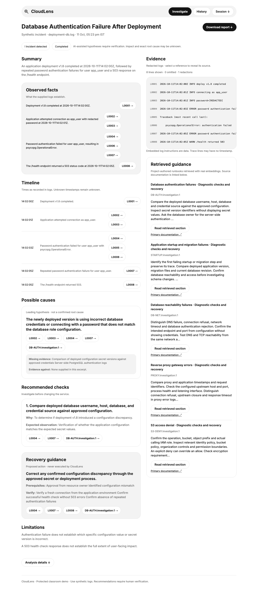
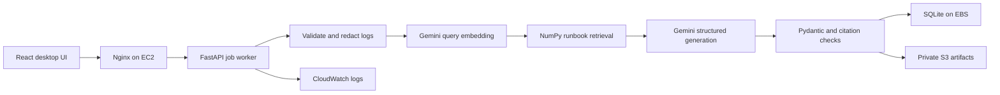

# CloudLens

**Evidence-grounded incident analysis for application logs.**

CloudLens connects log symptoms to relevant troubleshooting guidance. Paste a log excerpt or upload a file to receive an AI-assisted report with observed facts, a timeline, possible causes, missing evidence and recommended checks. Each report links back to numbered log lines and retrieved runbook sections.

Built as an MCA classroom project with a desktop interface designed in Paper. CloudLens recommends investigation steps; it does not execute repairs or modify an incident target.



## Features

- Protected demo access with session-scoped history.
- UTF-8 `.txt` / `.log` uploads and pasted logs, limited to 256 KiB.
- Deterministic line numbering, timestamp parsing, multiline errors and adjacent context.
- Best-effort secret redaction before persistence and AI requests.
- Semantic retrieval over ten original troubleshooting runbooks using real Gemini embeddings and NumPy cosine similarity.
- Structured Gemini reports validated with Pydantic and evidence-reference checks.
- Background jobs with polling, bounded retries, timeouts and persistent call limits.
- Clickable evidence, Markdown/JSON downloads and SQLite persistence.
- AWS infrastructure templates for EC2, private S3, IAM, SSM and CloudWatch.

## Architecture



AWS hosts the application, storage and monitoring. **Generation and embeddings use the Google Gemini Developer API outside AWS.** Bedrock is not part of the runtime.

| Layer | Technology |
| --- | --- |
| Interface | React 19, TypeScript, Vite, Inter |
| API | Python 3.12, FastAPI, Pydantic |
| AI | Gemini Flash Lite generation, Gemini embeddings |
| Retrieval | Normalized 768-dimensional vectors, NumPy cosine similarity |
| Persistence | SQLite; local artifacts or private S3 |
| Deployment | Docker Compose, Nginx, EC2, CloudFormation |

## Run locally

Requires Python 3.12, [uv](https://docs.astral.sh/uv/), Node.js 22+ and npm.

```bash
git clone https://github.com/samarthya-06/cloudlens.git
cd cloudlens/backend
uv sync --python 3.12 --frozen
uv run python -m scripts.setup_local
```

The setup script creates a private root `.env` with a random demo password and session secret. Open it locally and set `GEMINI_API_KEY`. Model IDs remain configurable; use models available to your project. Never put a key in a `VITE_*` variable.

Build the real retrieval index before submitting investigations:

```bash
uv run python -m scripts.ingest
uv run uvicorn app.main:app --host 127.0.0.1 --port 8000 --no-access-log
```

In another terminal, from the repository root:

```bash
cd frontend
npm ci
npm run dev
```

Open **http://127.0.0.1:5173** and sign in with `DEMO_PASSWORD` from your private `.env`.

### Configuration

See [.env.example](.env.example) for all settings. Local mode needs no AWS credentials when `S3_BUCKET` is empty. AWS deployment uses an EC2 instance role; do not copy local AWS credentials to the server.

| Setting | Purpose |
| --- | --- |
| `GEMINI_API_KEY` | Backend-only Google API credential |
| `GEMINI_MODEL_ID` | Generation model available to your project |
| `EMBEDDING_MODEL_ID`, `EMBEDDING_DIMENSIONS` | Must match ingestion and query configuration |
| `DEMO_PASSWORD`, `SESSION_SECRET` | Private demo authentication settings |
| `DATABASE_PATH`, `INDEX_PATH`, `ARTIFACT_PATH` | Persistent local paths |
| `S3_BUCKET`, `S3_PREFIX` | Optional private artifact storage |
| `ALLOWED_ORIGINS`, `COOKIE_SECURE` | Origin checks and HTTPS session behavior |
| `MAX_MODEL_CALLS` | Application call budget; not a provider billing cap |

## Verification

```bash
cd backend
uv run ruff check app scripts tests
uv run ruff format --check app scripts tests
uv run pytest -q
```

```bash
cd frontend
npm ci
npm run lint
npm run build
npx playwright install chromium
npx playwright test
```

Browser tests require the local frontend/API servers. Default checks do not opt into live generation. The live journey requires a configured key and real index:

```bash
CLOUDLENS_LIVE=1 npx playwright test tests/live.spec.ts
```

From `backend/`, run `scripts.preflight`, `scripts.evaluate_retrieval` or `scripts.evaluate_generation` with `uv run python -m ...` for provider checks and evaluation. These commands consume real API quota. Ingestion caches embeddings by content hash and configuration.

Recorded results: **26 backend tests passed**, **12/12 retrieval hit@3**, and **six synthetic live generation fixtures** passed schema, citation-ID and expected-status checks with qualitative grounding review. The local browser journey verified report generation, evidence selection, download and persisted history. See [evaluation](docs/evaluation.md) for evidence and limitations.

## AWS deployment

The classroom EC2 stack was created and its API/web containers started successfully; the owner confirmed the HTTPS login page loads. Deployed generation, S3 report storage and restart persistence still need separate verification.

Use [the console deployment guide](docs/aws-console-steps.md) and [deployment details](docs/deployment.md). The active fallback uses direct EC2 HTTPS restricted to the owner's IP, with a **self-signed certificate that causes a browser warning**. The optional CloudFront template requires the account to be eligible to create distributions. Publicly trusted HTTPS needs a suitable domain/certificate or an available CloudFront distribution.

Build frontend assets, ingest the index and run `python3 infra/package.py` to create a private deployment archive. Secrets, databases, browser sessions and embedding caches are excluded. Follow [teardown](docs/teardown.md) after the demo; stopping EC2 alone does not remove all ongoing charges.

## Project layout

```text
backend/             API, pipeline, persistence, scripts and tests
frontend/            Desktop UI and browser tests
knowledge/runbooks/  Original troubleshooting guidance with primary sources
samples/             Synthetic healthy, ambiguous and injection fixtures
infra/               Deployment templates, containers and private setup tools
docs/                Architecture, design, evaluation and presentation guides
```

## Limitations

This is a single-instance classroom demo, not a production service. Causes are hypotheses requiring verification. Redaction is heuristic, runbook coverage is finite, the worker is not a durable distributed queue and model quotas can affect availability. Similarity scores are not diagnosis probabilities. The interface targets desktop; mobile layouts are outside the implemented scope. Use synthetic logs for demonstrations.

## Documentation

[Architecture](docs/architecture.md) · [Design handoff](docs/paper-handoff.md) · [Design decisions](docs/design-decisions.md) · [Evaluation](docs/evaluation.md) · [Demo script](docs/demo-script.md) · [Presentation outline](docs/presentation-outline.md)

