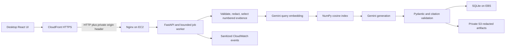

# Architecture

The cloud portion is prepared, not deployed. Local mode serves the API directly behind Vite's development proxy and writes artifacts to the ignored runtime directory.

Ten original runbooks cover database authentication/reachability, missing environment variables, S3 denial, timeouts, memory, disk, reverse proxy, startup/migrations and throttling. Each short runbook is one heading-preserving chunk, approximately 240–254 words, roughly the 300–500-token target. Because whole runbooks fit one chunk, overlap is unnecessary; unrelated documents are never joined. IDs and source metadata stay stable. Real Gemini embeddings are cached by content hash and configuration; `.npz` loading disables pickle. Query and document dimensions, normalization, model and region must match.

Parsing preserves original line numbers and unknown timestamps. Errors and warnings retain adjacent context and multiline traces. Evidence is bounded to 100 complete lines/20,000 characters; omitted counts remain visible. Redaction is heuristic and best-effort. Prompt contents are untrusted data. The report separates facts, hypotheses, missing evidence and checks. One bounded repair is allowed for invalid JSON/references, then generation fails while deterministic evidence remains available. Existing IDs do not prove semantic support; live outputs still require manual review.

There is one worker and a queue of four. SDK requests have timeouts; throttling/service-unavailable retries are capped at two attempts, each counted against the persistent budget. A timed-out SDK thread cannot be forcibly cancelled: the worker waits for it, discards late results and avoids overlapping another model job. This is not a durable distributed queue. Startup marks interrupted jobs failed. SQLite supports this single-instance demo, not multi-instance orchestration.

Sessions use random opaque HttpOnly cookies and HMAC-hashed token storage. The cookie is Secure in deployment and SameSite=Strict; state changes require an allowed Origin and CSRF token. Every incident/download route checks session ownership. Sessions last 24 hours; history survives process restarts within that session. Login, investigation count, queue size and total model calls are bounded.

## Regions

AWS infrastructure is in Mumbai (`ap-south-1`). Generation and embeddings use the Google Gemini Developer API over HTTPS. AI processing is external to AWS; this does not establish Mumbai-only inference. The Gemini key is injected privately on EC2, never sent to the frontend.

CloudFront uses its default HTTPS hostname. The prepared origin uses HTTP with restricted ingress and a secret origin header, so it is not end-to-end TLS. No browser receives AWS credentials. The runtime EC2 role has access only to the project S3 prefix, monitoring, its generated origin secret and SSM management. It has no incident-repair permissions.

Current implementation uses Gemini Developer API generation (`gemini-3.5-flash-lite`) and embeddings (`gemini-embedding-001`, normalized 768 dimensions). AWS hosts the planned application infrastructure; AI processing is external to AWS. Bedrock is no longer part of the application runtime. Live synthetic reports and retrieval results are saved in docs/evidence/runtime.
